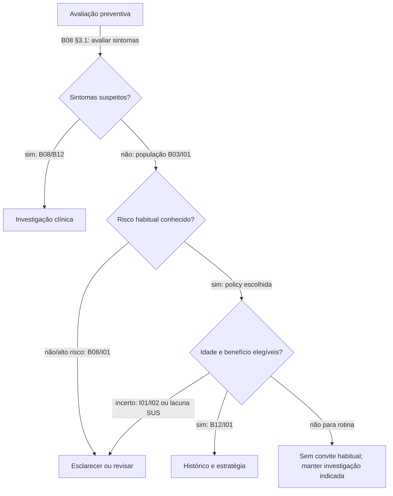
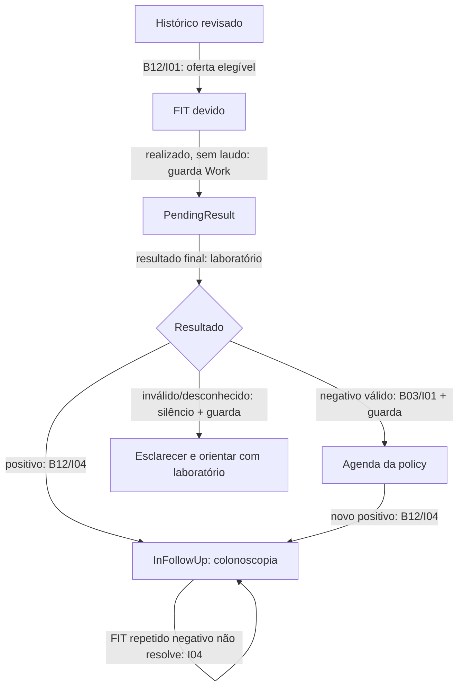
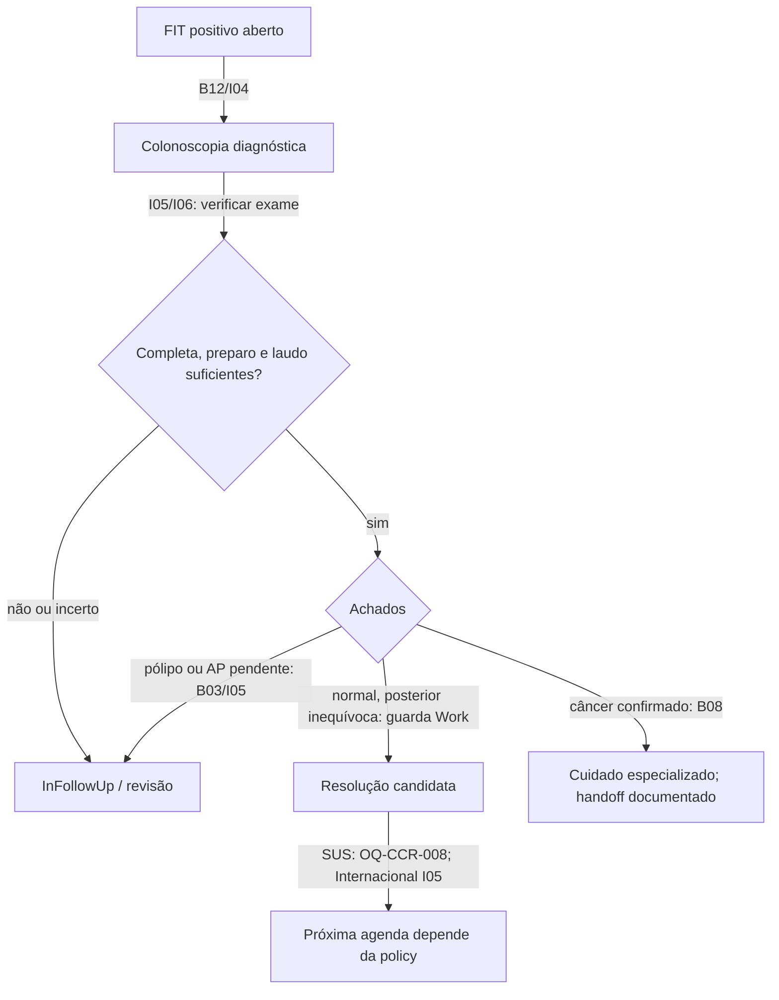

# 08 — Pathways longitudinais propostos e qualificadores

**awaiting_clinical_review.** Diagramas são especificação humana, não código executável. Cada seta é referida a uma fonte ou a uma guarda proposta do Work. A incerteza temporal segue a Foundation congelada, sem exceção por CCR.

## Decisões candidatas / tracks

| Decisão | Por que pode ser independente | Coordenação necessária |
|---|---|---|
| CRC_AVERAGE_RISK_SCREENING | Próxima oferta preventiva, dentro da policy | FIT e colonoscopia são estratégias da mesma decisão; não dois tracks apenas por modalidade |
| CRC_POSITIVE_STOOL_TEST_FOLLOWUP | Investigação de um gatilho anormal já identificado | Suprime oferta rotineira redundante; não deve desaparecer no teto etário |
| CRC_SPECIAL_RISK_REVIEW | Reconhecimento de população fora do piloto | Não significa módulo automático de genética/DII/pólipos |
| CRC_COLONOSCOPY_SURVEILLANCE | Decisão futura dependente de achados | Não desenvolver no piloto; revisão/handoff pode bastar |

Nomes provisórios. Supersedes opera dentro do track; não foi proposto usá-lo para silenciar outrotrack. A coordenação entre rotina e investigação precisa ser garantida pelo futuro conteúdo/resolver e seus gates, não por redesenho silencioso daengine (FG02).

## Entrada no risco habitual

Desconhecido não percorre seta “não”. A guarda de dados conhecidos é interpretação de segurança; o documento da fonte não descreve o formulário do Motor. “Sem convite” não impede diagnóstico.

## FIT e investigação

A coleta/resultado pendente não gera cobertura. Se já existe FIT positivo anterior, uma nova coleta pendente não o apaga: o track de investigação permanece InFollowUp; o resultado pendente pode ser registrado como condição adicional, sem substituir a obrigação diagnóstica.

## Colonoscopia e resolução

Cada ramo pressupõe indicação e datas: laudo normal de exame anterior ao gatilho não percorre “resolução candidata”. “Encaminhar” não é “já foi atendido”; HandedOff não é substituto automático de InFollowUp. Nenhum nó usa um estado inexistente “Surveillance”: surveillance é papel/contexto, representado no piloto por ClinicalReviewRequired ou HandedOff documentado.

## Tabela obrigatória de sequências

| Sequência | Interpretação candidata / estado | Reinicia rotina? | Fonte/localizador e natureza |
|---|---|---|---|
| FIT− final válido | Agenda da policy se nenhum gatilho aberto | Condicional à elegibilidade/dados | B03 rec.7 e comunicação; B12 p.17; I01 intervalos; guardas Work |
| FIT+ | InFollowUp; colonoscopia | Não | B12 pp.17–18; I04 Recommendation/summary |
| FIT+→FIT− | Continua investigação | Não | I04 positive FIT not repeat FIT; guarda de persistência Work |
| FIT+→colonoscopia posterior adequada normal | Resolução diagnóstica candidata; agenda depende de fonte/policy | SUS bloqueada; Internacional CCR-PROP-029 condicional | B05 PDF p.8 altera fluxo; I05 normal highquality/exceções |
| Colonoscopia normal→FIT+ posterior | Novo gatilho; não usar exame antigo como resolução | Não pelo exame anterior | I04 positive FIT/recent colonoscopy, fraca/baixa |
| FIT+→colonoscopia inadequada | InFollowUp; repetição/revisão | Não | I06 Management inadequate; I05 quality |
| FIT+→colonoscopia com adenoma | Sai da rotina simples; revisão de surveillance | Não intervalo habitual automático | B03 rec.8; I05 Tables 4–5 |
| FIT+→câncer confirmado | Encerra screening; handoff se comprovado | Não | B08 art.1; B03 rec.8 |
| FIT−→sintomas posteriores | Investigação; Current preventivo não impede saída | Não usar relógio como bloqueio | B08§3.1; B12 critérios |
| Vários FIT+→uma colonoscopia intermediária→novo FIT+ | Revisar vínculo por cronologia; último gatilho permanece aberto | Não por fechamento global do histórico | I04/I05 + guarda Work |
| AP pendente após ressecção | InFollowUp/ClinicalReviewRequired | Não inferir normal | B03 rec.8; I05 Tables 4–5; guarda Work |
| Mesmo dia/intervalos sobrepostos | Ordem não demonstrada: Indeterminate/revisão | Não presumir resolução | Contrato temporal da Foundation; nenhum estudo autoriza exceção aqui |

## Qualifying events e eventos não qualificadores

| Evento | Condições mínimas propostas | Efeito / origem de cada condição |
|---|---|---|
| FIT negativo | modalidade FIT, final, amostra aceitável, data; nenhum positivo aberto que exija diagnóstico | Intervalo B03/I01; final/validade e bloqueio longitudinal são interpretação de segurança CCR-PROP-016 |
| Colonoscopia normal primária | resultado realmente normal, laudo final, completa até o ceco, preparo adequado, sem exclusões, data | I05 Tables 3–4; estratégia I01/S01; definição operacional ainda revisável |
| Colonoscopia normal após FIT+ | mesmas condições + certamente posterior + indicação/episódio plausíveis | I05 premissas, I04 gatilho; ordem e vínculo são guardas Work; SUS não recebe agenda sem texto final brasileiro |
| FIT positivo | laudo positivo é gatilho | Não rotina; B12/I04 |
| FIT pendente/inválido | exame pode ter sido realizado, mas falta resultado interpretável | Não rotina; não equivale a not_performed; guarda Work |
| Colonoscopia incompleta/inadequada/qualidade unknown | falta confiabilidade de excluir lesão | Não normal qualificador; I05/I06 |
| Colonoscopia com pólipo ainda não caracterizado | falta histologia/tamanho/número se intervalo for pretendido | Sem surveillance automática; I05 |
| Encaminhamento isolado | não comprova realização nem fechamento | Não rotina/handoff concluído; guarda Work |
| Exame anterior ao FIT+ | não pode ser consequência do evento posterior | Não fecha episódio; I04 + temporal Foundation |

Não converter o booleano “resolutionInformation sufficient” em aprovação médica automática: ele deve representar informação de laudo/contexto revisada. Todos os IDs clínicos usados para explicar resolução devem existir no snapshot: gatilho + exame resolutivo e, quando necessário, fato diagnóstico.

## Histórico conhecido e comportamento sem qualificador

- never_performed é sobre **todo CCR**: se elegível e ausência verdadeira de qualquer exame, candidato Due, mediante declaração clínica explícita aprovada no conteúdo futuro.
- known com exames, mas sem qualificador: não concluir nunca realizado; esclarecer o que falta. Um FIT inválido não é teste de rastreio negativo.
- unknown é relato de desconhecimento; not_asked é ausência de pergunta (derivada pela Foundation de entrada ausente). Ambos são abstenção/esclarecimento, não Due por presunção.
- Colonoscopia realizada + “nunca FIT” não admite historyKnowledge CCR=never_performed; preservar histórico global known e discutir FG01, lacuna de modalidade.
- Qualificador conhecido pode sustentar Current mesmo com lacuna de outro histórico somente se não ocultar positivo/condição decisiva desconhecida. Revisor deve aprovar a semântica da história negativa suficientemente completa.

## Datas parciais

Data de exame em ano Y gera intervalo inclusivo existente na Foundation. A agenda é uma janela, sem inventar 01/01. Exemplo: asOf 23/10/2026, FIT− apenas 2025: no anual, vencimento entre 01/01 e 31/12/2026 é ambíguo; no bienal, janela 2027 inteiramente futura pode estar dentro do intervalo, desde que toda a qualificação seja conhecida. Datas possivelmente futuras ou exame futuro são inválidas/precisam de esclarecimento; não qualificam.

Para fechar FIT+, exigir ordem estrita certamente posterior. Mesmo dia/mês sobreposto continuam incertos; não inferir ordem pela digitação, ID ou preferência. Conhecer o dia é só necessário quando muda gate/agenda/ordem. Sem novas heurísticas.

## Foundation gaps candidatos

FG01 modalidade, FG02 coordenação/Current longitudinal, FG03 granularidade de dado inválido e FG04 SharedDecision estão em 13. São observações documentais, sem qualquer alteração da Foundation.
