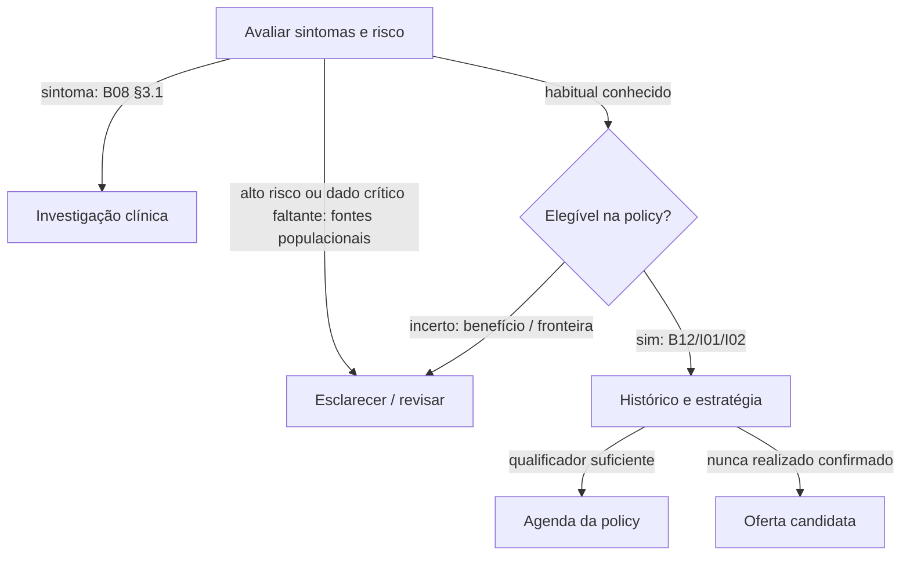
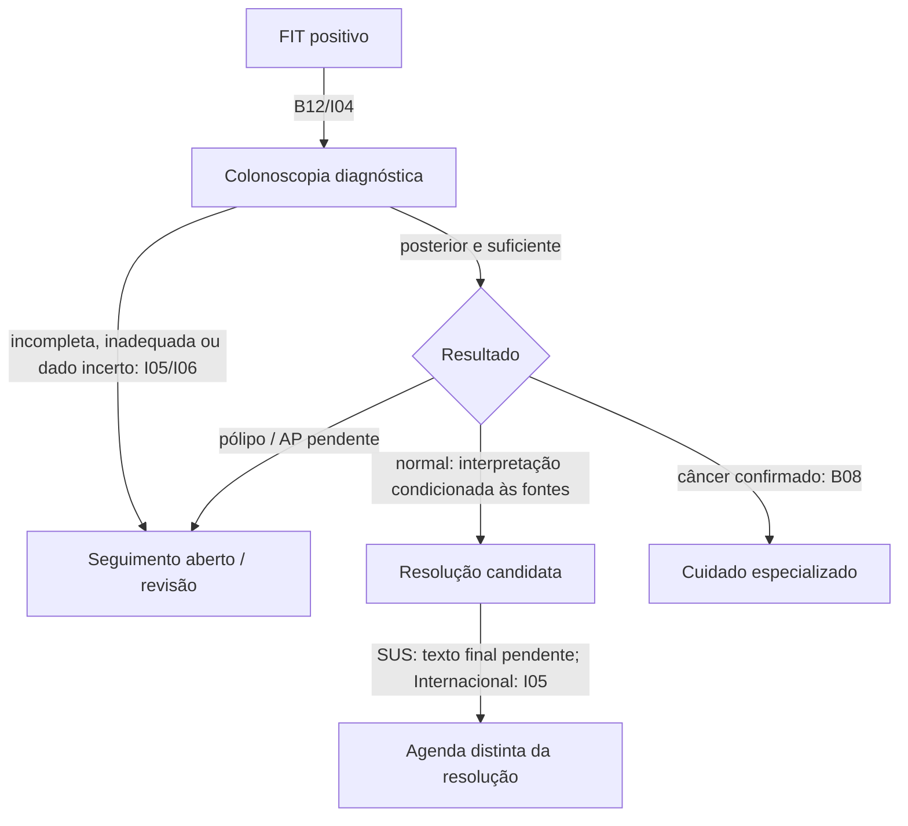

# 14 — Clinical review packet — CCR / Fase 5

**Documento principal para revisão humana.**
Data de corte: **23/10/2026**. Autoria: Work como proponente. Status de **todas as 45 proposições: awaiting_clinical_review**. Nenhuma fonte, interpretação ou política foi aprovada pelo autor como revisão clínica independente. Nenhum código clínico foi produzido.

## A. Veredito executivo

O candidato a piloto é pequeno: adulto assintomático de risco habitual, estratégia selecionada, FIT, investigação do resultado positivo, colonoscopia e saída segura da rotina. Não incluir surveillance completa, algoritmos hereditários ou tratamento.

Após aprovação humana, são candidatos à automação: gates explícitos de elegibilidade, intervalos ancorados em exames realmente qualificadores e reconhecimento de FIT positivo aberto. Continuam dependentes de guardas: dados críticos conhecidos, qualidade do exame, cronologia suficiente, ausência de achado pendente e policy escolhida.

**Não recomendo automatizar agora:** próxima agenda SUS após FIT+ e colonoscopia normal; ponto de corte numérico sem dispositivo/unidade; expectativa de vida; decisão no idoso; história familiar complexa; surveillance; repetição de FIT inválido sem instrução laboratorial; prazo universal após FIT+; fechamento por exame inadequado/antigo; substituição por indisponibilidade local. Os bloqueios são parte do resultado, não lacunas preenchidas com opinião.

## B. Estado brasileiro confirmado e pendente

| Tema | Situação em 23/10/2026 | Documento/localizador |
|---|---|---|
| Processo de elaboração | INCA/GT, painel e oito recomendações | B02 apresentação/painel, pp.3 e 9 |
| Consulta | CP20, 08–27/04/2026 | B04; B05 PDF p.8 |
| Deliberação pós-CP | Aprovação recomendada por unanimidade; Registro 1.107/2026 | B05 PDF p.11 |
| Texto preliminar | Continua identificado como preliminar; não promover a final | B03 capa e advertências |
| Fluxo pós-FIT+/colonoscopia | Ata registra que foi ajustado | B05 PDF p.8 |
| Diretriz final integral e portaria conjunta específica de screening | **Ainda não confirmadas/localizadas**, sem alegar inexistência | SA-02 |
| Núcleo operacional brasileiro | FIT bienal 50–75 e colonoscopia após positivo | B12 pp.17–18 impressas |
| Inclusão de agosto | Corroborada por notícia oficial; B06 lido em reprodução CONASS | B10/B06 Anexo I |
| Possível substituição publicada hoje | B07 relatado em dois espelhos: torna B06 sem efeito e muda cadastro | DOU primário inacessível; **SA-01**, não autenticado |
| Implantação | Anunciada para novembro, progressiva | B11 seção FIT, 20/10; não prova oferta universal hoje |

Os espelhos de B07 apontam 02.14.01.032-5 em lugar de 02.02.04.020-8 e efeitos na competência seguinte. Estes dados **não são cadastro vigente confirmado nesta execução**. Não se recomenda usar o código antigo por inércia nem adotar o novo sem conferir o primário.

Há três alertas na minuta: Figura 1 e texto da rec.8 não tornam inequívoca a próxima modalidade após colonoscopia normal; a ata informa ajuste; a rec.4 e sua discussão diferem na certeza de evidência. A ata menciona até 30 dias como referência de indicador em desenvolvimento, não prazo universal aqui confirmado.

## C. Política SUS proposta

| Pergunta | Resposta proposta / limite | Fonte |
|---|---|---|
| Quem | Assintomático, risco habitual conhecido; triagem de antecedentes/família e sintomas | B03 pressupostos; B08 §3.1; B12 |
| Idade | Início 50; teto descrito 75, com fronteira exata pendente | B12; B05; B03 rec.5–6 |
| Método/intervalo | FIT bienal; não colonoscopia primária por fallback | B12; B03 rec.2/7 |
| FIT negativo | Próxima rodada somente se final, amostra aceitável, data e sem gatilho aberto; guardas são propostas do Work | B03 comunicação/rec.7 + interpretação |
| FIT positivo | Colonoscopia diagnóstica; não reiniciar clock de rotina | B12; B03 rec.8 |
| Repetição de FIT após positivo | Não propor substituição da investigação; interpretação brasileira do fluxo, com fonte internacional explícita complementar se autorizada | B12/I04 |
| Colonoscopia normal posterior | Pode ser candidata a resolução diagnóstica se suficiente; próxima agenda SUS ainda bloqueada | B03/B05; OQ-CCR-008 |
| Inválido/pendente | Não são negativos; prazo de repetição não localizado; apoiar esclarecimento | Silêncio delimitado + guarda do Work |
| Sintoma, pólipo, DII, predisposição ou câncer | Sair da rotina apropriada e revisar/encaminhar; tratamento fora do piloto | B08/B03/B12 |

Não declarar pacientes sintomáticos “sem indicação” por idade. Nem todo familiar positivo exige o mesmo protocolo; desconhecido não é risco ausente. Sexo não altera as propostas populacionais selecionadas e não precisa ser coletado para esses gates.

## D. Brasil ampliado proposto

BA-A, **recomendação do Work ainda não aprovada**: núcleo brasileiro para FIT; S01 final para colonoscopia primária e conteúdo que explicitamente aborda; avaliação compartilhada 45–49; revisão de família e achados; pós-FIT+ com fonte brasileira ou complemento expressamente autorizado.

| Componente | Curadoria proposta | Decisão necessária |
|---|---|---|
| FIT | S01 descreve 1–2 anos; propor 2 alinhados ao núcleo B12 | Aprovar escolha, não dizer que SBOC só prescreve 2 |
| Colonoscopia primária | S01, 10 anos após negativo apropriado | Estratégia explícita, sem FIT simultâneo por padrão |
|45–49 | S01 qualifica antecipação; S03 orienta avaliação médica | Não transformar em consenso de rotina automática |
| Família / grupos especiais | Reconhecer e revisar | Não copiar algoritmo estrangeiro sem autorização |
| Pós-colonoscopia após FIT+ | Revisão até fonte/complemento definido | Não transportar intervalo primário automaticamente |
| Pólipos | Revisão/handoff | Sem surveillance completa |

Alternativas: BA-B antecipada/anual exige curadoria e fonte explícita; BA-C usa só brasileiras recuperadas e aceita mais abstenção. Complementação: primeiro reconhecer silêncio; depois propor documento brasileiro; internacional apenas com autorização por pergunta, população comparável e identificação da origem.

## E. Internacional — opções

| Pergunta | Opção A recomendada pelo Work | Opção B alternativa |
|---|---|---|
| Populacional | USPSTF 2021 final localizada | ACS 2026, atualização confirmada |
| Grades/faixas |45–49:B; 50–75:A; 76–85:C seletivo; interromper após 85 sem inventar grau D | Strong/qualified próprios; continuar até75 pressupõe boa saúde e expectativa de vida>10anos;76–85 individualizar; após85 desencorajar |
| Estratégia no piloto | FIT anual ou colonoscopia 10 anos, selecionados | Mesmas duas por limite do produto, apesar de menu maior na fonte |
| FIT positivo | USMSTF I04 | ACS e I04; orientação temporal qualificada |
| Seguimento / qualidade | USMSTF I05/I06 | Mesmos complementos |
| Família | ACG I03 apenas triagem e revisão no piloto | Mesmo |

ACS 2026 inclui novidades fora do piloto; não tratá-la como guideline 2018 nem importar sua atualização para USPSTF. I08 é posição ACG, não substituto da ACG2021. I04–I06 têm **acesso primário parcial**; antes de codificar, conferir integral e exceções. Opção A permanece proposta.

## F. Pathway habitual

A ausência de registros não percorre a seta “nunca realizado”. Preferência e capacidade de completar investigação importam. “Não elegível ao convite” não significa “não investigar”.

## G. Pathway FIT positivo e resolução

FIT negativo repetido não resolve o positivo; colonoscopia anterior também não. Mesmo dia ou datas sobrepostas não demonstram ordem. Handoff só com transferência conhecida; recomendação de encaminhamento mantém seguimento.

## H. Qualifying events e sequência

| Evento | Pode ancorar rotina? | Condição / fundamento |
|---|---|---|
| FIT− | Candidato, sim | Final/aceitável/data e sem positivo aberto; intervalo da policy |
| FIT+ | Não | Gatilho de investigação B12/I04 |
| Pendente/inválido | Não | Não há resultado negativo interpretável; guarda |
| Colonoscopia normal primária | Candidato, sim | Completa, preparo adequado, laudo e risco; I05/I01/S01 |
| Colonoscopia normal após FIT+ | Resolução e novo clock são decisões separadas | SUS bloqueado para próxima agenda; Internacional I05 com exceções e acesso integral pendente |
| Incompleta/inadequada/“sem câncer” com achado pendente | Não automaticamente | Qualidade e significado de normal não demonstrados |
| Encaminhamento/colonoscopia anterior ao gatilho | Não fecha episódio | Não há evidência resolutiva posterior |

Intervalos documentados são 1 ano para FIT da opção A, 2 anos propostos no SUS e 10 anos para colonoscopia normal apropriada nas fontes pertinentes; nenhum deles vale para toda colonoscopia ou todo resultado.

## I. Dados necessários

| Decisão | Required / conditional | Não exigir sem efeito |
|---|---|---|
| Elegibilidade | Policy/asOf, idade, sintomas e triagem de risco conhecidos | Sexo ou nascimento completo quando idade basta |
| Agenda FIT | Resultado final/validade, data e precisão, histórico de gatilho aberto | Número bruto/unidade se laudo categórico é suficiente |
| Resolver episódio | FIT+, exame posterior, qualidade/completude, laudo/achados e vínculo | Histologia de todos os pacientes sem lesão |
| Família positiva | Grau, número, tipo e idade quando mudam rota | Pedigree detalhado para resposta negativa conhecida |
| Idoso | Saúde/benefício, histórico e preferência avaliados por humano | Sobrevida calculada apenas por idade |
| Operação | Recurso e rota local conhecidos quando ação depende deles | Município como elegibilidade biológica ou CPF/CNS |

“Não”, “não sei” e “não perguntei” permanecem distintos. never_performed é global no tópico: colonoscopia existente impede “nunca realizou CCR”, mesmo que nunca tenha feito FIT. Datas parciais geram janelas, sem dias inventados.

## J. Divergências relevantes

| Questão | Diferença | Classificação |
|---|---|---|
|45–49 | Convite SUS50 versus oferta USPSTF45 versus BAem revisão | conduct_changing_difference |
| FIT negativo há 18 meses | Bienal SUS versus anual Internacional | conduct_changing_difference |
| Pós-colonoscopia normal | Lacuna do texto final SUS versus I05 especializado | not_comparable como concordância comprovada |
| HF jovem versus risco habitual | Populações distintas | not_comparable |
| Até 30 dias em indicador versus 6 meses preferenciais ACS | Tipos de orientação e contextos distintos | not_comparable como deadline universal |
| Grade SBOC/USPSTF/ACS/GRADE | Sistemas distintos | Não converter para pontuação universal |

## K. Conteúdo não automatizável e risco

| Risco de interpretação errada | Consequência | Mitigação proposta |
|---|---|---|
| Repetir FIT para resolver FIT+ | Perda de investigação | Manter gatilho aberto e evidência usada |
| Colonoscopia antiga como resolução | Falsa tranquilização | Exigir ordem certa e suficiência |
| Unknown como “nunca” | Agenda falsa | Pergunta/estado explícitos |
| Alto risco na rotina comum | Subtratamento/intervalo inadequado | Triagem e revisão |
| Minuta ou notícia como norma completa | Política sem autoridade | Status e localizador por proposição |
| Misturar SUS e internacional | Idade/intervalo sem governante | Uma curadoria por policy |
| “Sem câncer” como normal | Perda de surveillance ou diagnóstico | Conferir achados/AP/qualidade |
| Indisponibilidade como “sem indicação” | Abandono de cuidado | Separar recomendação e rota |
| Meta temporal como prazo legal | Informação operacional falsa | Distinguir indicador, recomendação e norma |

Não automatizar expectativa de vida, genética, surveillance completa, correção de unidades, ordem do mesmo dia ou fallback por recurso.

## L. Questões abertas por impacto

**14 P0:** OQ-CCR-001 texto final SUS; 002 ato administrativo do corte; 003 teto 75; 005 laudo versus limiar numérico; 007 tempo pós-FIT+; 008 pós-colonoscopia; 011 limite de pólipos; 012 risco habitual/dados críticos; 013 qualidade; 014 vínculo longitudinal; 017 Internacional; 018 benefício no idoso; 020 acesso integral aos complementos; 021 Brasil ampliado.

**9 P1:** OQ-CCR-004 âncora de data; 006 grade da minuta; 009 triagem de sintomas; 010 comprovação dehandoff; 015 inválido/pendente; 016 repetição de inadequada; 019 SharedDecision; 022 rota local; 023 coordenação de conteúdo. Itens P2 (módulos completos/novos testes/UI/persistência) são adiáveis. Prioridade vale para o conteúdo afetado, sem fingir que tudo está aprovado.

## M. Proposições candidatas

P0 01–009: núcleo SUS e lacunas. P0 10–015: saídas de risco/sintomas. P0 16–022: resultados e sequência. P0 23–030: opção Internacional A e complementos. P0 31–033: família ACG somente apoio/revisão. P0 34–036: curadoria BA. P0 37: opção ACS. P0 38–042: limite de surveillance, qualidade, radiação e operação. P0 43–045: recursos e coordenação. Todas têm fonte/localizador, grade quando disponível, stance, computability, dados/guardas e status não revisado; IDs são de proposição, não regras.

## N. Casos adversariais

60 candidate clinical cases, não executáveis. Cobrem as 40 situações mínimas do contrato e variantes: mesma data, intervalos sobrepostos, vários positivos, AP pendente, cancelamento, negativo antigo seguido de inválido, história por modalidade, mudança de policy, data futura e novo sintoma durante intervalo.

Exemplos críticos para validar diretamente na fonte: FIT+→FIT− mantém seguimento; colonoscopia antiga→FIT+ não resolve; normal após FIT+ tem agenda SUS pendente; preparo inadequado mantém investigação; 47 anos difere por policy; relato somente 2025 pode atravessar vencimento anual; polipectomia prévia não vira habitual por um único exame posterior normal.

## O. Foundation gaps e limites

Inspeção somente leitura em 8c 63356:
- **FG01, candidato:** histórico por tópico versus “nunca FIT, mas fez colonoscopia”; fatos adicionais existentes/revisão podem bastar.
- **FG02, candidato:** coordenação entre rotina e follow-up e Current longitudinal; resolver não cria Current nem ignora Conflict. Precisa prova de representabilidade futura com conteúdo seguro.
- **FG03, limitação confirmada:** semanticIssues por domínio pode bloquear todo CCR por dado inválido de outro track; granularidade continua adiada.
- **FG04, limitação confirmada:** parcialmente computável vai para ClinicalReviewRequired antes de SharedDecision; apoio à decisão pode representar a conversa sem redesenho.

Não há evidência nesta pesquisa de que uma mudança de engine seja inevitável. Nenhuma mudança foi feita. Cada candidato exige cenário, fonte, impacto e alternativa mínima, sem usar pesquisa clínica para redesenhar a Foundation silenciosamente.

## P. Decisões que exigem aprovação humana

1. Obter/autenticar diretriz final SUS e ato administrativo do corte; aceitar os limites enquanto faltarem.
2. Escolher BA-A/alternativa e Internacional A/B, com complementos por pergunta.
3. Aprovar elegibilidade, teto 75, triagem de alto risco, dados mínimos e limites no idoso.
4. Definir resolução de FIT+ e próxima agenda separadamente por policy; aprovar qualificadores/qualidade/data âncora.
5. Delimitar pólipos/surveillance como revisão/handoff no piloto.
6. Aprovar os expected documentais a partir das fontes e confirmar integral dos complementos antes de gerar regras ou golden patients.

Este pacote não registra aceitação de nenhuma dessas decisões.

## Fontes essenciais — URLs diretas e localizadores

- **B02** MS/INCA, [Relatório GT2025](https://ninho.inca.gov.br/jspui/bitstream/123456789/17247/3/Relat%C3%B3rio%202025%20do%20GT%20de%20Rastreamento%20CCR.pdf), pp.3, 7, 9, 12–13. Técnico final de atividades.
- **B03** MS/Conitec, [relatório preliminar CP20](https://www.gov.br/conitec/pt-br/midias/consultas/relatorios/2026/relatorio-preliminar-diretrizes-brasileiras-do-rastreamento-do-cancer-de-colon-e-reto-cp-20/@@display-file/file), março 2026. Figura 1 PDF p.10; rec.1–8; rec.8 PDF p.23. **PRELIMINARY**.
- **B05** Conitec, [ata 152ª](https://www.gov.br/conitec/pt-br/midias/reuniao_conitec/2026/ata-da-152o-reuniao-da-conitec_pcdt_site/@@display-file/file), junho 2026, PDFpp.8–11. Ata final de deliberação.
- **B06** [reprodução CONASS da Portaria 4.642](https://www.conass.org.br/conass-informa-n-158-2026-publicada-portaria-saes-ms-n-4-642-que-inclui-procedimento-e-altera-atributos-de-procedimento-da-tabela-de-procedimentos-medicamentos-orteses-proteses-e-m/), Anexo I. Histórico; possível substituição B07.
- **B07** [URL DOU Portaria 5.215](https://www.in.gov.br/web/dou/-/portaria-saes/ms-n-5.215-de-22-de-outubro-de-2026-739944058), 23/10/2026; art.5/anexos. **Acesso primário bloqueado**. [Reprodução LegisMap](https://legismap.com.br/leis-e-normas/portaria-saes-ms-n-5-215-de-22-10-2026), sem promoção a autenticado.
- **B08** MS, [PCDT final/Portaria Conjunta 25](https://www.gov.br/conitec/pt-br/midias/protocolos/adenocarcinoma-de-colon-e-de-reto-pcdt/@@display-file/file), 17/11/2025, art.1/3 e §3.1 p.3. Doença estabelecida/diagnóstico, não guideline completa de screening.
- **B11** MS, [anúncio 20/10/2026](https://www.gov.br/saude/pt-br/assuntos/noticias-ms/2026/outubro/ministerio-da-saude-amplia-acesso-a-medicamentos-oncologicos-de-alta-tecnologia-no-rio-de-janeiro), seção FIT. Comunicação de implantação.
- **B12** MS, [protocolo OCI oncologia 2026](https://www.gov.br/saude/pt-br/composicao/saes/agora-tem-especialistas/publicacoes/protocolo-de-acesso-as-ofertas-de-cuidados-integrados-em-oncologia.pdf/@@download/file), pp.17–18 impressas. Técnico operacional final.
- **S01** SBOC, [Cólon:doençalocalizadav6 FINAL](https://sboc.org.br/wp-content/uploads/2026/04/Diretrizes-SBOC-2026-C%E2%94%9C%E2%94%82lon-doen%E2%94%9Coa-localizada-v6-VERS%E2%94%9CaO-FINAL.pdf), 18/05/2026, pp.4–6. Seção de screening em guideline terapêutica; NE/FR próprios.
- **S03** SBCP, [posição 05/10/2023](https://sbcp.org.br/medico/american-college-of-physicians-recomenda-rastreio-do-cancer-colorretal-a-partir-dos-50-anos/), parágrafos finais. Orientação institucional, sem guideline graduada completa.
- **I01** [USPSTF final 2021](https://www.uspreventiveservicestaskforce.org/uspstf/recommendation/colorectal-cancer-screening), Summary, Population, Starting/stopping ages e Intervals.
- **I02** ACS, [update 2026](https://acsjournals.onlinelibrary.wiley.com/doi/10.3322/caac.70083), Table 1/rationale. Grade strong/qualified própria; atualização real.
- **I03** ACG, [artigo 2021](https://medicine.uams.edu/familymedicine/wp-content/uploads/sites/7/2021/07/ACG_Clinical_Guidelines__Colorectal_Cancer.14.pdf), Table 1 p.460, rec.9–12; GRADE preservado.
- **I04** USMSTF, [FIT 2017](https://www.asge.org/docs/default-source/education/practice_guidelines/fecal_immunochemical_testing.pdf), Recommendation/summary. Trechos primários indexados; integral bloqueada. FIT+→colo: forte/moderada; após colo recente: fraca/baixa.
- **I05** USMSTF, [follow-up 2020](https://www.asge.org/docs/default-source/guidelines/recommendations-for-follow-up-after-colonoscopy-and-polypectomy-a-consensus-update-by-the-us-multi-society-task-force-on-colorectal-cancer-2020-march-gie.pdf), Tables 3–5/Normal high-quality. Acesso parcial. Normal de qualidade 10 anos: forte/alta, com exceções.
- **I06** USMSTF, [preparo 2025](https://www.asge.org/home/resources/publications/guidelines/optimizing-bowel-preparation-quality-for-colonoscopy--consensus-recommendations-by-the-us-multi-society-task-force-on-colorectal-cancer), Table 2/Management — inadequate. Acesso parcial; repetição forte/moderada.
- **I08** ACG, [posição 01/06/2026](https://webfiles.gi.org/links/media/ACG_ACS_CRC_Screening_Guideline_Blood_Test_06012026.pdf), pp.1–2. Não é guideline substituta.

## O que ainda não estamos perguntando?

Possível colectomia/anatomia residual; laudo dizendo “normal” com lesão antiga relevante; pessoa que faria teste mas recusaria colonoscopia/tratamento; FIT de investigação sintomática confundido com screening; falso positivo por outra causa alegada; falta de histórico de biópsia; resultados fora de programa; condição clínica nova durante intervalo; conhecimento incompleto de positivos antigos; exposição/indicação da radioterapia; garantia de qualidade do serviço além do relato do paciente.

Não abrir protocolos para todos esses cenários: definir gate de revisão/fora do escopo, com fonte própria, antes de ampliar automação.

**Parada obrigatória: documentação da Fase 5. Sem regras, resolver clínico, golden tests executáveis, alteração da Foundation, merge ou publicação.**
